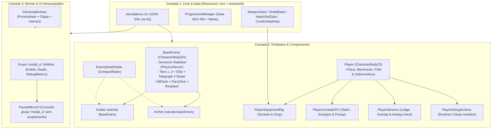

# Levantamento Arquitetural Completo do Projeto & Plano de Padronização (Industry Standard)

> **Status Geral do Plano:** ✅ **CONCLUÍDO** (6/6 Fases Finalizadas, Validadas e em Produção)

> [!IMPORTANT]
> ## OBJETIVO DESTE DOCUMENTO
> Este documento consolida a **Auditoria Técnica Completa** de todos os subsistemas de **Severed Dawn** (`entities`, `combat`, `world`, `ui`, `core` e `tools`) e registra o roteiro em **Fases Testáveis** concluído para elevar o repositório ao padrão de engenharia da indústria (*Dead Cells / Motion Twin*, *Hollow Knight*, *Nine Sols*), culminando no guia definitivo de criação de novos scripts referenciado como **Regra de Ouro** em [`docs/REGRAS_DO_PROJETO.md`](REGRAS_DO_PROJETO.md).

---

## 1. Auditoria Global do Projeto (Por Subsistema — Diagnóstico Original & Resolução)

### 1.1. Subsistema de Inimigos (`src/entities/enemies/`) *(Resolvido)*
* **Duplicação Massiva (~70% — Resolvido nas Fases 1–3):** [`soldier.gd`](../src/entities/enemies/melee/soldier/soldier.gd) (425 $\rightarrow$ 157 linhas) e [`archer.gd`](../src/entities/enemies/ranged/archer/archer.gd) (366 $\rightarrow$ 112 linhas) passaram a estender [`BaseEnemy`](../src/entities/enemies/base_enemy.gd), eliminando a duplicação de Tiers, telegraphs, flash, respawn e lógica de cooldown.
* **Sensores Espalhados (Resolvido):** Removidos os 5 nós `RayCast2D` de [`archer.tscn`](../src/entities/enemies/ranged/archer/archer.tscn) e os raycasts manuais nos estados do `Soldier`; todos os inimigos usam os sensores *stateless* (`PhysicsRayQueryParameters2D`) de `BaseEnemy`.
* **Estados Idênticos Duplicados (Resolvido):** Removidos `soldier/states/death_state.gd` e `archer/states/death_state.gd`; ambos agora apontam `StateMachine/Death` para o script único [`EnemyDeathState`](../src/entities/enemies/states/enemy_death_state.gd).
* **3 Bugs Silenciosos (Corrigidos em `BaseEnemy`):** Tier 3 funcional no `Archer`, preservação da escala `1.15x` de Elite no flip e suporte unificado a `apply_parry_stun()`.

---

### 1.2. Subsistema do Jogador & Equipamentos (`src/entities/player/` & `src/combat/`) *(Resolvido)*
* **`Player` como *God Object* (1.502 $\rightarrow$ 791 linhas — Resolvido nas Fases 4 e 6):** [`player.gd`](../src/entities/player/player.gd) foi modularizado em sub-controladores especializados mantendo as fachadas públicas intactas:
  1. [`PlayerEquipmentRig`](../src/entities/player/player_equipment_rig.gd) (sockets frame a frame e drop físico na morte).
  2. [`PlayerCombatVFX`](../src/entities/player/player_combat_vfx.gd) (*Slash VFX*, *Energize* e *Pickup Burst*).
  3. [`PlayerSensors`](../src/entities/player/player_sensors.gd) (*ledge climb* em 4 estágios, colisão suave e deadzone analógica).
  4. [`PlayerDebugActions`](../src/entities/player/player_debug_actions.gd) (atalhos de teste isolados em `OS.is_debug_build()`).
  5. [`WeaponData.get_archetype_id()`](../src/combat/weapon_data.gd) (tipagem direta substituindo inspeção solta de string).
* **Código Morto (Resolvido):** Removido [`weapon_socket_config.gd`](../src/entities/player/weapon_socket_config.gd) (347 linhas obsoletas).
* **Ferramenta Crítica de Calibração ([`src/tools/weapon_socket_calibrator.gd`](../src/tools/weapon_socket_calibrator.gd) — 1.304 linhas):** Paridade matemática 1:1 preservada e formalizada em contrato na Fase 4 e em [`PADRAO_ARQUITETURAL_DE_SCRIPTS.md`](PADRAO_ARQUITETURAL_DE_SCRIPTS.md).

---

### 1.3. Subsistema de Mundo & Interações (`src/world/`) *(Resolvido)*
* O boilerplate repetido de `body_entered` / `body_exited` e clique de mouse entre NPCs e o portal em [`family_house.gd`](../src/world/hub/family_house.gd) foi consolidado no componente reutilizável [`InteractableArea`](../src/world/components/interactable_area.gd) (com suporte a nó direto na árvore e `InteractableArea.bind_area(...)`). O antigo Baú de Armas estático também foi removido em favor do sorteio dinâmico Melee+Ranged por run nos [`WeaponPedestal`](../src/world/hub/weapon_pedestal.gd).

---

### 1.4. Subsistema de UI, Hub & Localização (`src/ui/` & `src/core/`) *(Resolvido)*
* **Conformidade com a Regra 10 (Resolvido na Fase 5):** Todas as strings do jogador que estavam hardcoded em [`hud.gd`](../src/ui/hud.gd), [`weapon_pedestal.gd`](../src/world/hub/weapon_pedestal.gd), [`progression_manager.gd`](../src/core/progression_manager.gd), [`mother_dialog_ui.gd`](../src/ui/hub/mother_dialog_ui.gd), [`brother_forge_ui.gd`](../src/ui/hub/brother_forge_ui.gd) e [`player.gd`](../src/entities/player/player.gd) foram migradas para [`translations.csv`](../src/core/localization/translations.csv) com tradução contextualizada *humanlike* (`pt_BR` e `en_US`).
* **Desacoplamento de Modais (Resolvido na Fase 5):** `MotherDialogUI`, `BrotherForgeUI`, `TouchOfDeathUI` e `DebugMetricsPanel` agora usam o grupo `"modal_ui"`, permitindo que [`pause_menu_ui.gd`](../src/ui/pause/pause_menu_ui.gd) verifique `_is_any_modal_open()` sem `find_child()` nominal.

---

## 2. Arquitetura Alvo do Projeto (Visão Macro)

---

## 3. Plano de Execução Passo a Passo (6 Fases Testáveis — Todas Concluídas)

Cada fase foi executada individualmente, validada via `Godot_v4.7.2-stable_win64_console.exe --headless --editor --quit --path . 2>&1` e testada pelo PO antes de avançar.

### 📦 FASE 1 — Fundação `BaseEnemy` & Estado Compartilhado `EnemyDeathState` *(Concluída)*
* **O que foi feito:**
  1. Criado [`src/entities/enemies/base_enemy.gd`](../src/entities/enemies/base_enemy.gd) (`class_name BaseEnemy extends CharacterBody2D`) unificando Stats, Tiers 1–3, Elite (`1.15x`), `update_facing()`, Telegraph dos 3 sinais, `advance_attack_cycle()`, `apply_parry_stun()`, `on_attack_blocked()`, `hit_flash`, `respawn()` e sensores espaciais stateless (`can_step_forward`, `can_step_backward`, `is_at_ledge`, `is_hitting_wall`, `has_line_of_sight_to`, `find_player`).
  2. Criado [`src/entities/enemies/states/enemy_death_state.gd`](../src/entities/enemies/states/enemy_death_state.gd) (`class_name EnemyDeathState extends State`) unificando a lógica de morte, recompensa no `ProgressionManager` e respawn.
* **Critério de Teste (Fase 1):** Compilação headless limpa com registro de `BaseEnemy` e `EnemyDeathState`.

---

### 🏹 FASE 2 — Migração do `Archer` para `BaseEnemy` & Limpeza de `archer.tscn` *(Concluída)*
* **O que foi feito:**
  1. Refatorado [`archer.gd`](../src/entities/enemies/ranged/archer/archer.gd) para herdar de `BaseEnemy` (~366 $\rightarrow$ ~110 linhas).
  2. Removidos os 5 nós `RayCast2D` (`WallCheck`, `LedgeCheck`, `BackWallCheck`, `BackLedgeCheck`, `SightRay`) de [`archer.tscn`](../src/entities/enemies/ranged/archer/archer.tscn).
  3. Apontado o nó `StateMachine/Death` do `Archer` para `EnemyDeathState` e removido código duplicado nos estados do `Archer`.
* **Critério de Teste (Fase 2):** No `movement_gym`, o `Archer` patrulha na plataforma `Step4` sem cair, faz *kite*, atira com os 3 sinais, sofre *Parry Stun*, morre/renasce e escala corretamente para o **Tier 3** (`T`).

---

### ⚔️ FASE 3 — Migração do `Soldier` para `BaseEnemy` & Limpeza dos Estados Melee *(Concluída)*
* **O que foi feito:**
  1. Refatorado [`soldier.gd`](../src/entities/enemies/melee/soldier/soldier.gd) para herdar de `BaseEnemy` (~425 $\rightarrow$ ~140 linhas).
  2. Limpos [`soldier/states/patrol_state.gd`](../src/entities/enemies/melee/soldier/states/patrol_state.gd) e [`soldier/states/chase_state.gd`](../src/entities/enemies/melee/soldier/states/chase_state.gd) para usar os sensores de `BaseEnemy` (eliminando `_is_at_ledge`, `_is_hitting_wall`, `_can_see_player`, `_get_player`, `_has_los_to_player` duplicados).
  3. Apontado `StateMachine/Death` do `Soldier` para `EnemyDeathState` e removidos os scripts `death_state.gd` duplicados de `soldier` e `archer`.
* **Critério de Teste (Fase 3):** Combate completo contra `Soldier` e `Archer`, verificando que o `Soldier` Elite mantém a escala `1.15x` ao virar de lado, respeita stunlock vs. hyper-armor e contabiliza kills/almas.

---

### 🗡️ FASE 4 — Modularização do `Player`, Tipagem em `WeaponData` & Remoção de Dead Code *(Concluída)*
* **O que foi feito:**
  1. Removido o arquivo morto [`src/entities/player/weapon_socket_config.gd`](../src/entities/player/weapon_socket_config.gd) (347 linhas não utilizadas).
  2. Adicionado `get_archetype_id() -> String` diretamente em [`src/combat/weapon_data.gd`](../src/combat/weapon_data.gd).
  3. Extraído o gerenciamento de sockets e drop de equipamentos na morte para [`src/entities/player/player_equipment_rig.gd`](../src/entities/player/player_equipment_rig.gd) (`class_name PlayerEquipmentRig`).
  4. Extraído o gerenciamento de *Slash VFX*, *Energize* e *Pickup VFX* para [`src/entities/player/player_combat_vfx.gd`](../src/entities/player/player_combat_vfx.gd) (`class_name PlayerCombatVFX`), mantendo todas as assinaturas públicas em `player.gd` como fachadas intactas para compatibilidade 100% com os estados e o `WeaponSocketCalibrator`.

#### Contrato de Invariância e Compatibilidade 100% com o `WeaponSocketCalibrator` (`src/tools/weapon_socket_calibrator.gd`)
Durante e após a modularização do `Player`, os contratos abaixo **NÃO podem ser alterados** para garantir que futuras calibrações no [`weapon_socket_calibrator.tscn`](../src/tools/weapon_socket_calibrator.tscn) continuem refletindo exatamente o jogo:
1. **Dependências de Recursos Compartilhados (Imutáveis):**
   * `WeaponSocketProfile` (`get_frame_data`, `get_back_frame_data`, `set_hand_custom_data`, `set_back_frame_data`) nos perfis `res://src/entities/equipment/socket_profiles/*.tres`.
   * `WeaponData` (`get_socket_profile`, `get_step_total_slash_offset`, `get_step_total_slash_scale`, `get_step_slash_flip_h`, `get_step_slash_flip_v`, `get_step_slash_animation`, `make_slash_frame_key`, `slash_offset`, `slash_scale`, `slash_step_offsets`, `slash_step_scales`, `slash_frame_offsets`, `slash_frame_scales`).
   * `AttackSetData` e `ComboStepData` (`get_frame_slash_offset`, `get_frame_slash_scale`, `step_frame_slash_offsets`, `step_frame_air_slash_offsets`, `step_frame_slash_scales`, `step_frame_air_slash_scales`).
2. **Paridade Matemática 1:1 entre `WeaponSocketCalibrator` e `PlayerEquipmentRig` / `PlayerCombatVFX`:**
   * Manter a mesma hierarquia e nomes dos 6 sockets sob `Visual` em [`player.tscn`](../src/entities/player/player.tscn): `MainHandSocket`, `OffHandSocket`, `BackSocketWeapon`, `BackSocketShield`, `TeaBottleSocket`, `ItemPickupSocket`, além de `SlashEffect`.
   * Manter a mesma âncora base do sprite (`Vector2(-2, -29)` geral e `Vector2(-6.5, 4.0)` para `corner_climb`).
   * Manter a mesma regra de flip de instância (`_apply_visual_instance_flip`, preservando módulo da escala com fallback `0.8`), defaults de `pos`/`rot`/`z_index` por socket (incluindo `z_index = 2` em `corner_climb` quando `< 1`, e `z_index = 1` para `dagger` nas costas) e cálculo de `SlashEffect` (`base_pos + custom_offset`).
3. **Fachada Pública Intacta em `player.gd`:**
   * Manter em `Player` os métodos `_update_weapon_socket_for_frame(anim_name, frame_idx)`, `update_slash_frame_transform(frame_idx)`, `set_slash_visual(...)`, `equip_weapon(...)`, `equip_secondary_weapon(...)`, `equip_shield(...)` e `set_shield_raised(...)` como fachadas delegando para `PlayerEquipmentRig` e `PlayerCombatVFX`.

* **Critério de Teste (Fase 4):** Testar troca de armas (`1`/`2`), ataques terrestres/aéreos, *Slash VFX*, carga *Energize*, escudo/parry, cura (`Q`), coleta (`E`), morte com drop físico e validar explicitamente o [`weapon_socket_calibrator.tscn`](../src/tools/weapon_socket_calibrator.tscn) (troca de arma/escudo/animação/frame, preview de slash e salvamento no `.tres`).

---

### 🌐 FASE 5 — Conformidade Total de i18n (Regra 10) & Desacoplamento de Modais UI *(Concluída)*
* **O que foi feito:**
  1. Cadastradas em [`src/core/localization/translations.csv`](../src/core/localization/translations.csv) (com tradução contextual *humanlike* `pt_BR` e `en_US`) todas as strings que estavam hardcoded em:
     * `src/ui/hud.gd` (status de escudo, morte, repulsão e toast de Tier)
     * `src/entities/player/player.gd` (nomes de Tier)
     * `src/world/hub/weapon_pedestal.gd` (barks e avisos de pedestal)
     * `src/core/progression_manager.gd` (nomes de armas e metas de desbloqueio dos pedestais)
     * `src/ui/hub/mother_dialog_ui.gd` e `src/ui/hub/brother_forge_ui.gd` (labels de nível, dano e requisitos)
  2. Adicionados os modais (`MotherDialogUI`, `BrotherForgeUI`, `TouchOfDeathUI`, `DebugMetricsPanel`) ao grupo `"modal_ui"` e simplificado `PauseMenuUI._try_open_pause_menu()` para checar `_is_any_modal_open()` via grupo em vez de `find_child()` nominal.
* **Critério de Teste (Fase 5):** Testar HUD, pedestais da Casa Familiar, diálogos da Mãe/Irmão/Morte e Menu de Pausa sem nenhuma string hardcoded restante.

---

### 📜 FASE 6 — Guia Oficial de Criação de Scripts, Hardening AA/Big Tech & Regra de Ouro *(Concluída)*
* **O que foi feito:**
  1. Criado e consolidado o documento normativo [`docs/PADRAO_ARQUITETURAL_DE_SCRIPTS.md`](PADRAO_ARQUITETURAL_DE_SCRIPTS.md) com padrão completo de engenharia de estúdio: orçamento de linhas por categoria, Tabela Oficial de Physics Layers/Masks, Blueprint de árvore `.tscn` para `BaseEnemy` e Modais UI, imutabilidade de `.tres` em runtime, padrão *Call Down / Signal Up* e escopo claro entre UI do jogador vs. ferramentas DEV.
  2. Extraídos [`PlayerSensors`](../src/entities/player/player_sensors.gd) (sensores espaciais, *ledge climb* e deadzone analógica) e [`PlayerDebugActions`](../src/entities/player/player_debug_actions.gd) (atalhos de debug isolados em `OS.is_debug_build()`) de `player.gd` (~978 $\rightarrow$ 791 linhas).
  3. Criado [`InteractableArea`](../src/world/components/interactable_area.gd) (`src/world/components/interactable_area.gd`) e aplicado em [`family_house.gd`](../src/world/hub/family_house.gd).
  4. Protegida a imutabilidade de `.tres` em [`progression_manager.gd`](../src/core/progression_manager.gd) via `.duplicate()` antes do escalonamento de dano em runtime.
  5. Atualizado [`docs/REGRAS_DO_PROJETO.md`](REGRAS_DO_PROJETO.md) (Leitura Obrigatória, Regra 11 e Índice Mestre dos 12 documentos em `docs/`) e [`docs/SISTEMA_VIDA_MORTE_CURA_E_HUB.md`](SISTEMA_VIDA_MORTE_CURA_E_HUB.md) (remoção do Baú de Armas + Draft Dinâmico Melee/Ranged nos pedestais).
* **Critério de Teste (Fase 6):** Revisão da documentação pelo PO e validação headless final do repositório (`player.gd`, `family_house.tscn` e `movement_gym.tscn`).
