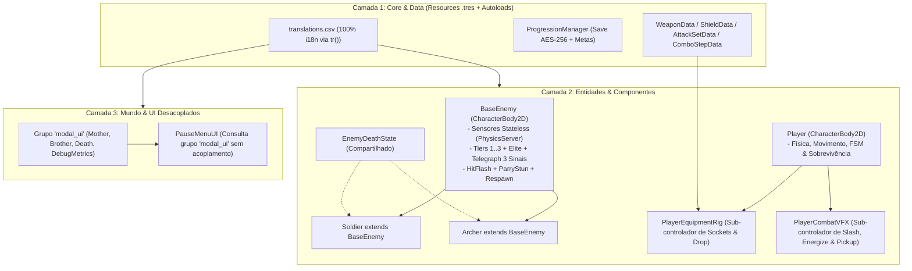

# Levantamento Arquitetural Completo do Projeto & Plano de Padronização (Industry Standard)

> [!IMPORTANT]
> ## OBJETIVO DESTE DOCUMENTO
> Este documento consolida a **Auditoria Técnica Completa** de todos os subsistemas de **Severed Dawn** (`entities`, `combat`, `world`, `ui`, `core` e `tools`) e estabelece o roteiro em **Fases Testáveis** para elevar o repositório ao padrão de engenharia da indústria (*Dead Cells / Motion Twin*, *Hollow Knight*, *Nine Sols*), culminando no guia definitivo de criação de novos scripts referenciado como **Regra de Ouro** em [`docs/REGRAS_DO_PROJETO.md`](REGRAS_DO_PROJETO.md).

---

## 1. Auditoria Global do Projeto (Por Subsistema)

### 1.1. Subsistema de Inimigos (`src/entities/enemies/`)
* **Duplicação Massiva (~70%):** [`soldier.gd`](../src/entities/enemies/melee/soldier/soldier.gd) (425 linhas) e [`archer.gd`](../src/entities/enemies/ranged/archer/archer.gd) (366 linhas) duplicam `enum CooldownBehavior`, todos os `@export` de Stats/Percepção/Tiers/Respawn, `apply_tier_by_level()`, `can_step_forward()`, `can_step_backward()`, `has_line_of_sight_to()`, `show/hide_telegraph()`, `on_attack_blocked()`, shader de `hit_flash` e `respawn()`.
* **Sensores Espalhados em 4 Lugares:**
  * `Archer` usa 5 nós `RayCast2D` na cena [`archer.tscn`](../src/entities/enemies/ranged/archer/archer.tscn) sincronizados manualmente no flip.
  * `Soldier` usa `PhysicsRayQueryParameters2D` em `soldier.gd`, mas [`soldier/states/patrol_state.gd`](../src/entities/enemies/melee/soldier/states/patrol_state.gd) e [`soldier/states/chase_state.gd`](../src/entities/enemies/melee/soldier/states/chase_state.gd) reescrevem `_is_at_ledge()`, `_is_hitting_wall()` e `_has_los_to_player()` por conta própria.
* **Estados Idênticos Duplicados:** [`soldier/states/death_state.gd`](../src/entities/enemies/melee/soldier/states/death_state.gd) e [`archer/states/death_state.gd`](../src/entities/enemies/ranged/archer/states/death_state.gd) são 98% idênticos.
* **3 Bugs Silenciosos Encontrados:**
  1. `Archer.apply_tier_by_level()` não possui o bloco `if active_tier >= 3:` (Archers Tier 3 usam atributos de Tier 2).
  2. `Soldier.update_facing()` reseta `visual.scale.x = ±1.0`, apagando a escala `1.15x` de Elite no primeiro giro de patrulha.
  3. `Archer` não implementa `apply_parry_stun()`.

---

### 1.2. Subsistema do Jogador & Equipamentos (`src/entities/player/` & `src/combat/`)
* **`Player` como *God Object* (1.502 linhas):** [`player.gd`](../src/entities/player/player.gd) mistura 5 domínios distintos no mesmo arquivo:
  1. Física de movimentação, *coyote/buffer*, *ledge climb*, *Life Rally* e saúde.
  2. Rig visual de equipamentos e sincronização frame a frame de 6 sockets (~350 linhas).
  3. Controlador de VFX de combate (*Slash VFX*, shader/partículas de *Energize*, impacto de chão e *Pickup Burst* — ~220 linhas).
  4. Detecção de arquétipo de arma por inspeção de string (`_detect_weapon_type_string`: `if "dagger" in res_path...`) em vez de propriedade tipada no `WeaponData`.
  5. Atalhos de debug (`T`, `Y`, `2`, `3`) acoplados direto no `_unhandled_input` do herói.
* **Código Morto (Dead Code — 347 linhas):** [`src/entities/player/weapon_socket_config.gd`](../src/entities/player/weapon_socket_config.gd) (`class_name WeaponSocketConfig`) não é referenciado em nenhum lugar do projeto (foi substituído por `WeaponSocketProfile` `.tres`), mas ainda é compilado globalmente.

---

### 1.3. Subsistema de Mundo & Interações (`src/world/`)
* **Falta de Componente Único de Interação (Violação da Regra 9):**
  * [`family_house.gd`](../src/world/hub/family_house.gd) (Baú, Rack, Mãe, Irmão, Portal), [`weapon_pedestal.gd`](../src/world/hub/weapon_pedestal.gd) e [`pickup_item.gd`](../src/world/items/pickup_item.gd) reimplementam manualmente a detecção de proximidade (`body_entered` / `body_exited`), clique de mouse (`input_event`) e tecla `interact`.

---

### 1.4. Subsistema de UI, Hub & Localização (`src/ui/` & `src/core/`)
* **Violações da Regra 10 (Strings Hardcoded em Português fora do `translations.csv`):**
  1. [`src/ui/hud.gd`](../src/ui/hud.gd): `"⚔️ INIMIGOS: TIER %d [%s] - LV %d (Tecla T)"`, `"● O SANGUE CESSA..."`, `"● ESCUDO BLOQUEADO: %.1fs"`, `"● ESCUDO EM GUARDA"`, `"● ESCUDO PRONTO"`, `" [REPULSÃO ATIVA]"`.
  2. [`src/world/hub/weapon_pedestal.gd`](../src/world/hub/weapon_pedestal.gd): `"Trocou escudo: "`, `"Escudo Equipado: "`, `"Escudo guardado no pedestal."`, `"Pedestal Vazio."`, `"Equipado na mão: "`, `"Equipado nas costas: "`, `"Trocou de arma: "`, `"Arma guardada no pedestal."`, `"[Trancado] "`.
  3. [`src/core/progression_manager.gd`](../src/core/progression_manager.gd): Dicionário `WEAPON_DISPLAY_NAMES` e todas as strings de `get_weapon_pedestal_condition_text()` / `get_shield_pedestal_condition_text()`.
  4. [`src/ui/hub/mother_dialog_ui.gd`](../src/ui/hub/mother_dialog_ui.gd) e [`src/ui/hub/brother_forge_ui.gd`](../src/ui/hub/brother_forge_ui.gd): `"Nível "`, `"Feixes: "`, `"Dano: "`, `"Receitas Repetidas: "`.
  5. [`src/entities/player/player.gd`](../src/entities/player/player.gd): `"RECRUTA"`, `"VETERANO"`, `"ELITE"`.
* **Acoplamento de Modais no `PauseMenuUI`:**
  * [`pause_menu_ui.gd`](../src/ui/pause/pause_menu_ui.gd) faz `find_child("MotherDialogUI")`, `find_child("BrotherForgeUI")`, `find_child("TouchOfDeathUI")` e `find_child("DebugMetricsPanel")` nominalmente. Usar o grupo `"modal_ui"` desacopla o menu de pausa de qualquer nova janela futura.

---

## 2. Arquitetura Alvo do Projeto (Visão Macro)

---

## 3. Plano de Execução Passo a Passo (6 Fases Testáveis)

Cada fase será executada individualmente, validada via `Godot_v4.7.2-stable_win64_console.exe --headless --editor --quit --path . 2>&1` e testada pelo PO antes de avançar.

### 📦 FASE 1 — Fundação `BaseEnemy` & Estado Compartilhado `EnemyDeathState` *(Concluída)*
* **O que foi feito:**
  1. Criado [`src/entities/enemies/base_enemy.gd`](../src/entities/enemies/base_enemy.gd) (`class_name BaseEnemy extends CharacterBody2D`) unificando Stats, Tiers 1–3, Elite (`1.15x`), `update_facing()`, Telegraph dos 3 sinais, `advance_attack_cycle()`, `apply_parry_stun()`, `on_attack_blocked()`, `hit_flash`, `respawn()` e sensores espaciais stateless (`can_step_forward`, `can_step_backward`, `is_at_ledge`, `is_hitting_wall`, `has_line_of_sight_to`, `find_player`).
  2. Criado [`src/entities/enemies/states/enemy_death_state.gd`](../src/entities/enemies/states/enemy_death_state.gd) (`class_name EnemyDeathState extends State`) unificando a lógica de morte, recompensa no `ProgressionManager` e respawn.
* **Critério de Teste (Fase 1):** Compilação headless limpa com registro de `BaseEnemy` e `EnemyDeathState`.

---

### 🏹 FASE 2 — Migração do `Archer` para `BaseEnemy` & Limpeza de `archer.tscn` *(Concluída)*
* **O que foi feito:**
  1. Refatorado [`archer.gd`](../src/entities/enemies/ranged/archer/archer.gd) para herdar de `BaseEnemy` (~366 $\rightarrow$ ~110 linhas).
  2. Removidos os 5 nós `RayCast2D` (`WallCheck`, `LedgeCheck`, `BackWallCheck`, `BackLedgeCheck`, `SightRay`) de [`archer.tscn`](../src/entities/enemies/ranged/archer/archer.tscn).
  3. Apontado o nó `StateMachine/Death` do `Archer` para `EnemyDeathState` e removido código duplicado nos estados do `Archer`.
* **Critério de Teste (Fase 2):** No `movement_gym`, o `Archer` patrulha na plataforma `Step4` sem cair, faz *kite*, atira com os 3 sinais, sofre *Parry Stun*, morre/renasce e escala corretamente para o **Tier 3** (`T`).

---

### ⚔️ FASE 3 — Migração do `Soldier` para `BaseEnemy` & Limpeza dos Estados Melee
* **O que será feito:**
  1. Refatorar [`soldier.gd`](../src/entities/enemies/melee/soldier/soldier.gd) para herdar de `BaseEnemy` (~425 $\rightarrow$ ~140 linhas).
  2. Limpar [`soldier/states/patrol_state.gd`](../src/entities/enemies/melee/soldier/states/patrol_state.gd) e [`soldier/states/chase_state.gd`](../src/entities/enemies/melee/soldier/states/chase_state.gd) para usarem os sensores de `BaseEnemy` (eliminando `_is_at_ledge`, `_is_hitting_wall`, `_can_see_player`, `_get_player`, `_has_los_to_player` duplicados).
  3. Apontar `StateMachine/Death` do `Soldier` para `EnemyDeathState` e remover os scripts `death_state.gd` duplicados de `soldier` e `archer`.
* **Critério de Teste (Fase 3):** Combate completo contra `Soldier` e `Archer`, verificando que o `Soldier` Elite mantém a escala `1.15x` ao virar de lado, respeita stunlock vs. hyper-armor e contabiliza kills/almas.

---

### 🗡️ FASE 4 — Modularização do `Player`, Tipagem em `WeaponData` & Remoção de Dead Code
* **O que será feito:**
  1. Remover o arquivo morto [`src/entities/player/weapon_socket_config.gd`](../src/entities/player/weapon_socket_config.gd) (347 linhas não utilizadas).
  2. Adicionar `get_archetype_id() -> String` diretamente em [`src/combat/weapon_data.gd`](../src/combat/weapon_data.gd).
  3. Extrair o gerenciamento de sockets e drop de equipamentos na morte para [`src/entities/player/player_equipment_rig.gd`](../src/entities/player/player_equipment_rig.gd) (`class_name PlayerEquipmentRig`).
  4. Extrair o gerenciamento de *Slash VFX*, *Energize* e *Pickup VFX* para [`src/entities/player/player_combat_vfx.gd`](../src/entities/player/player_combat_vfx.gd) (`class_name PlayerCombatVFX`), mantendo as assinaturas públicas em `player.gd` intactas para não quebrar nenhum estado ou o `WeaponSocketCalibrator`.
* **Critério de Teste (Fase 4):** Testar troca de armas (`1`/`2`), ataques terrestres/aéreos, *Slash VFX*, carga *Energize*, escudo/parry, cura (`Q`), coleta (`E`), morte com drop físico e o `weapon_socket_calibrator.tscn`.

---

### 🌐 FASE 5 — Conformidade Total de i18n (Regra 10) & Desacoplamento de Modais UI
* **O que será feito:**
  1. Cadastrar em [`src/core/localization/translations.csv`](../src/core/localization/translations.csv) (com tradução *humanlike* `pt_BR` e `en_US`) todas as strings hoje hardcoded em:
     * `src/ui/hud.gd` (status de escudo, morte, repulsão e toast de Tier)
     * `src/entities/player/player.gd` (nomes de Tier)
     * `src/world/hub/weapon_pedestal.gd` (barks e avisos de pedestal)
     * `src/core/progression_manager.gd` (nomes de armas e metas de desbloqueio dos pedestais)
     * `src/ui/hub/mother_dialog_ui.gd` e `src/ui/hub/brother_forge_ui.gd` (labels de nível, dano e requisitos)
  2. Adicionar os modais (`MotherDialogUI`, `BrotherForgeUI`, `TouchOfDeathUI`, `DebugMetricsPanel`) ao grupo `"modal_ui"` e simplificar `PauseMenuUI._try_open_pause_menu()` para checar o grupo em vez de `find_child()` nominal.
* **Critério de Teste (Fase 5):** Testar HUD, pedestais da Casa Familiar, diálogos da Mãe/Irmão/Morte e Menu de Pausa sem nenhuma string hardcoded restante.

---

### 📜 FASE 6 — Guia Oficial de Criação de Scripts & Regra de Ouro em `REGRAS_DO_PROJETO.md`
* **O que será feito:**
  1. Criar o documento normativo [`docs/PADRAO_ARQUITETURAL_DE_SCRIPTS.md`](PADRAO_ARQUITETURAL_DE_SCRIPTS.md) especificando **exatamente como todo novo script deve ser criado daqui para frente**:
     * **Novos Inimigos:** Devem obrigatoriamente estender `BaseEnemy`, reutilizar `EnemyDeathState`, usar sensores do `BaseEnemy` (proibido criar nós `RayCast2D` soltos para borda/parede) e expor apenas estados específicos do seu arquétipo.
     * **Novas Armas / Golpes:** Devem ser 100% Data-Driven via `WeaponData` + `AttackSetData` + `ComboStepData` ([`docs/ARQUITETURA_ATTACK_SETS_E_SLASHES.md`](ARQUITETURA_ATTACK_SETS_E_SLASHES.md)), sem `if/else` de nome de arma em código.
     * **Novas Responsabilidades do Player:** Física/estados ficam em `src/entities/player/states/`; visuais de socket vão em `PlayerEquipmentRig`; efeitos de combate/partículas vão em `PlayerCombatVFX` (proibido inflar `player.gd`).
     * **Novas Telas / Modais de UI:** Devem pertencer ao grupo `"modal_ui"`, consumir 100% dos textos de `translations.csv` via `tr()` e usar `GamepadPromptBar`.
     * **Limite de Responsabilidade Única (SRP):** Scripts de entidade/controlador não devem ultrapassar ~350–400 linhas nem misturar física, UI e VFX no mesmo arquivo.
  2. Atualizar [`docs/REGRAS_DO_PROJETO.md`](REGRAS_DO_PROJETO.md) incluindo [`docs/PADRAO_ARQUITETURAL_DE_SCRIPTS.md`](PADRAO_ARQUITETURAL_DE_SCRIPTS.md) na **Leitura Obrigatória do Topo** e como **Regra de Ouro Arquitetural** para qualquer novo código.
* **Critério de Teste (Fase 6):** Revisão da documentação pelo PO e validação headless final do repositório.
