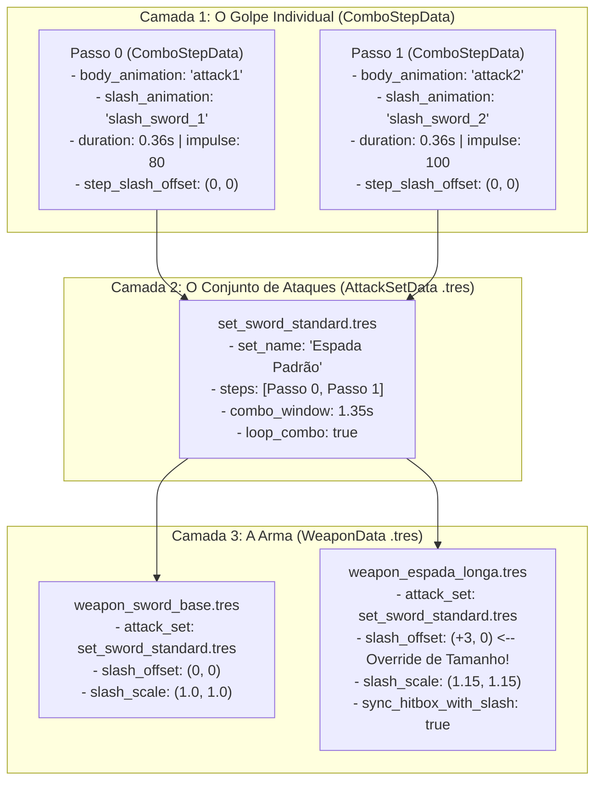

# Arquitetura de Attack Sets, Combos Modulares e Slashes por Golpe

> [!IMPORTANT]
> ## OBJETIVO DESTE DOCUMENTO
> Este documento especifica o plano arquitetural e o guia definitivo de operação do **Sistema Modular de Combate Baseado em Attack Sets (`AttackSetData` + `ComboStepData` + `WeaponData`)**.
> 
> Qualquer agente de IA ou desenvolvedor que for criar novas armas, novos conjuntos de movimentos (*movesets*), novas poses de ataque (`attack1`, `attack2`, `attack3`, `attack4`...) ou novos efeitos visuais de corte (*slashes*) **deve seguir estritamente esta arquitetura**.

---

## 1. Contexto e Motivação Técnica

No início do protótipo, a lógica de sequência de ataques estava acoplada diretamente dentro do estado [`src/entities/player/states/attack_state.gd`](../src/entities/player/states/attack_state.gd) (forçando `Passo 0 = attack1`, `Passo 1 = attack2`, `Passo 2 = attack3`) e cada arma ([`src/combat/weapon_data.gd`](../src/combat/weapon_data.gd)) possuía apenas uma única variável `slash_animation` para todos os golpes.

Essa abordagem inicial apresentava três limitações críticas para a evolução do jogo:
1. **Sequências Rígidas:** Armas pesadas como o *War Hammer* ou o *Battle Axe* precisam ter sequências próprias de ataques no futuro (ex: `attack2 -> attack4` ou `attack4 -> attack5`), diferentes da sequência de uma espada rápida.
2. **Slash Único por Arma:** O arco visual do efeito de corte (*slash*) muda drasticamente do `attack1` (corte descendente) para o `attack2` (estocada/corte ascendente). Uma arma não pode tocar o mesmo desenho de slash em todos os passos do combo.
3. **Variação de Tamanho Físico entre Armas do Mesmo Set:** Duas espadas podem compartilhar o mesmo conjunto de movimentos (*Set*), mas uma *Espada Longa* pode ser 3 ou 5 pixels mais comprida que uma *Espada Curta*, exigindo um ajuste fino (*offset override*) na própria arma para que o efeito de corte e a *hitbox* acompanhem a ponta da lâmina sem precisar duplicar o Set.

---

## 2. Referências de Mercado (Levantamento Técnico)

A arquitetura adotada neste projeto baseia-se diretamente nos três principais referenciais modernos de ação 2D:

### 2.1. Dead Cells & Castlevania: Belmont's Curse (Motion Twin / Evil Empire)
* **Arquitetura Data-Driven (CastleDB):** Nenhuma sequência de combo é escrita em código (`if/else`). O personagem possui um catálogo bruto de animações corporais (`attack1`, `attack2`, `attack3`, etc.), e os movimentos são organizados em **Movesets / Sets de Ataque**.
* **Reutilização por Arquétipo:** Em *Belmont's Curse*, diversas armas dentro de uma mesma categoria (ex: *Longswords*, *Greatswords*, *Dual Blades*) compartilham o mesmo Set de movimentos base, mudando apenas atributos da arma (dano, cor elemental, escala e alcance).
* **Slash VFX por Passo do Combo:** Cada passo individual dentro da sequência define qual animação de rastro/corte (`SlashVFX`) deve ser disparada naquele golpe específico, sincronizada com a pose do corpo.

### 2.2. Nine Sols (Red Candle Games)
* **Coreografia por Passo (`ComboStep`):** Cada golpe da sequência é modelado como uma unidade atômica de dados que amarra:
  1. A animação do corpo (`body_animation`),
  2. A animação do corte (`slash_animation`) correspondente ao ângulo daquele golpe,
  3. O tempo de duração (`duration`), impulso físico (`forward_impulse`) e multiplicador de dano daquele passo.
* **Fidelidade Visual de Alcance (Spacing):** O jogador utiliza o desenho do *slash* como referência visual exata da área de acerto. Se o *slash* de uma arma é deslocado para frente ou ampliado, a *Hitbox* acompanha proporcionalmente para que o visual nunca minta para o jogador.

---

## 3. Visão Geral da Nova Arquitetura (3 Camadas de Resources)

O sistema é dividido em **3 níveis modulares de Custom Resources (`.tres`)**, todos 100% editáveis pelo **Inspector Visual do Godot**:

---

### 3.1. Fórmula de Composição Aditiva (Set + Arma)

Quando o jogador executa o golpe de índice `i` no combo, o motor calcula a animação, posição, escala e hitbox combinando os dados do **Set** com os overrides da **Arma**:

1. **Qual Animação do Corpo tocar?**
   * Lê `step.body_animation` do `AttackSetData` (ex: `&"attack1"` no passo 0, `&"attack2"` no passo 1).
   * O sistema de sockets (`WeaponSocketProfile`) usa automaticamente esse nome de animação para posicionar a arma na mão e nas costas frame a frame!

2. **Qual Animação de Slash tocar?**
   * **Prioridade 1 (Override por Passo na Arma):** Se a arma preencheu `slash_step_animations[i]`, usa a animação específica da arma para aquele passo.
   * **Prioridade 2 (Padrão do Passo no Set):** Caso contrário, usa `step.slash_animation` definido no `AttackSetData` (ex: `slash_sword_1` para o ataque 1, `slash_sword_2` para o ataque 2).
   * **Prioridade 3 (Fallback Global da Arma):** Se o passo do Set estiver vazio, usa `weapon.slash_animation`.

3. **Qual a Posição Final do Slash? (Soma Aditiva):**
   $$\text{Posição Final} = \text{Origem do Pé} + \text{Offset do Passo (no Set)} + \text{Offset Global da Arma (ex: +3 no X)} + \text{Offset por Passo da Arma (Opcional)}$$
   > **Nota sobre Direção (`facing_direction`):** Como o nó `Visual` do jogador já é espelhado horizontalmente (`scale.x = -1` ao olhar para a esquerda), qualquer valor positivo em `X` (como `+3`) empurra o slash **sempre para a frente da lâmina**, independentemente do lado para o qual o personagem está olhando!

4. **Qual a Escala Final do Slash? (Multiplicativa):**
   $$\text{Escala Final} = \text{Escala do Passo (no Set)} \times \text{Escala Global da Arma} \times \text{Escala por Passo da Arma (Opcional)}$$

5. **Sincronização Automática da Hitbox Física com o Slash:**
   * Se `weapon.sync_hitbox_with_slash` estiver ativo (`true` por padrão):
     * A largura e altura da `Hitbox` escalam proporcionalmente com a escala do slash e somam `weapon.hitbox_extra_reach`.
     * A posição `X` da `Hitbox` avança automaticamente somando o `slash_offset.x` da arma (ex: se você colocou `+3` no X porque a arma é mais longa, a caixa de dano também avança `+3px` para frente!).

6. **⚠️ REGRA DE OURO (PASSO ESSENCIAL PARA AGENTES): Sincronia de Frames do Slash e Janela Ativa da Hitbox (`active_start_frame` / `active_end_frame`):**
   * Seguindo o padrão da indústria (*Dead Cells*, *Blasphemous*, *Nine Sols*), a `Hitbox` **JAMAIS** deve ligar no Frame 0 durante o *Windup* (preparação com a arma indo para trás).
   * Sempre que um agente criar ou atualizar um ataque/slash, **É OBRIGATÓRIO**:
     1. **Manter a grade completa de frames no `slash_frames.tres`:** Se a animação do corpo tem `N` frames (ex: 5 frames no `attack1` ou 6 frames no `attack2` e `attack3`), a animação de slash correspondente **DEVE ter exatamente os mesmos `N` frames** (incluindo os frames iniciais vazios de *Windup* e o frame final vazio de *Recovery*), além de remover os pixels amarelos marcadores do pé de todas as células.
     2. **Configurar `active_start_frame` e `active_end_frame` no `ComboStepData` (`src/combat/sets/*.tres`):**
        * **`active_start_frame`**: Deve ser o **exato índice do frame (base 0) em que o desenho da meia-lua do slash surge na tela** (ex: Frame `2` no `attack1` / `slash_sword`, Frame `3` no `attack2` / `slash_sword_2`, Frame `2` no `attack3` / `slash_sword_3`). É neste milissegundo exato que o `AttackState` liga a `Hitbox` e libera `100%` do impulso frontal (`forward_impulse`).
        * **`active_end_frame`**: Deve ser o último frame em que o rastro do slash ainda causa dano antes de entrar em *Recovery* (ex: Frame `3` no `attack1`, Frame `4` no `attack2`, Frame `3` no `attack3`). Após este frame, a `Hitbox` é desligada imediatamente.
     3. **Ajustar `hitbox_size` e `hitbox_position` conforme a anatomia do golpe/categoria:** Armas curtas (Adaga: `28x24`), médias (Espada: `32x28`), pesadas (Martelo: `34x30`) ou estocadas longas (Lança: ex. `52x12` em `X=30`) devem ter sua caixa base calibrada no `ComboStepData` do seu respectivo Set.

---

## 4. Especificação de Todas as Opções Customizáveis (`@export`) no Editor da Godot

Todos os campos possuem comentários de documentação `##` no código GDScript para que, ao passar o mouse em cima de qualquer propriedade no **Inspector do Godot**, a descrição completa apareça na tela, além de um cabeçalho explicativo em cada recurso.

### 4.1. Recurso `ComboStepData` (`src/combat/combo_step_data.gd`)
Representa **1 golpe individual** dentro de um Set de Ataque.

| Propriedade (`@export`) | Tipo | Valor Padrão | O que faz no Editor Visual da Godot |
| :--- | :--- | :--- | :--- |
| **`step_label`** | `String` | `"Golpe 1"` | Nome organizacional deste passo no Inspector (ex: `"Golpe 1 - Corte Vertical"`, `"Golpe 2 - Estocada"`). |
| **`body_animation`** | `StringName` | `&"attack1"` | Nome exato da animação do corpo do personagem em `player_frames.tres` (ex: `attack1`, `attack2`, `attack3`). Também dita qual pose o socket da mão/costas vai usar! |
| **`duration`** | `float` | `0.36` | Tempo total de execução deste golpe em segundos. A velocidade da animação do corpo e do slash se ajustam automaticamente para caber neste tempo. |
| **`forward_impulse`** | `float` | `80.0` | Impulso físico horizontal (em px/s) que projeta o personagem para frente ao desferir este golpe. |
| **`damage_multiplier`** | `float` | `1.0` | Multiplicador de dano específico deste golpe (ex: `1.0` no golpe 1, `1.25` no golpe 2, `1.5` num golpe final pesado). Multiplica o `base_damage` da arma. |
| **`next_step_window`** | `float` | `0.0` | Janela máxima de oportunidade (em segundos) após terminar este golpe para engatar o próximo passo do combo antes de resetar para o Golpe 1 (`1.35s` do Golpe 1 -> 2; `0.675s` do Golpe 2 -> 3 para exigir compromisso imediato no finalizador). Se `0.0`, usa o `combo_window` do Set. |
| **`lock_dodge_after_windup`** | `bool` | `false` | Se `true` (padrão no Golpe 3), permite cancelar o golpe com Slide/Roll **apenas durante a preparação/giro inicial** (antes de `active_start_frame`). Depois que o corte é desferido, bloqueia o Slide até o final da pausa de recuperação! |
| **`slash_animation`** | `StringName` | `&"slash_sword"` | Nome da animação de efeito de corte (em `slash_frames.tres`) que acompanha este golpe específico (ex: `slash_sword_1` no ataque 1, `slash_sword_2` no ataque 2). |
| **`step_slash_offset`** | `Vector2` | `Vector2(0, 0)` | Deslocamento base (em pixels) do efeito de corte para esta pose de ataque. `X+` move para frente do golpe; `Y-` move para cima; `Y+` move para baixo. |
| **`step_slash_scale`** | `Vector2` | `Vector2(1, 1)` | Escala base do efeito de corte para este passo (ex: `(1.2, 1.2)` se este golpe específico tiver um arco mais amplo). |
| **`step_slash_flip_h`** | `bool` | `false` | Se `true`, espelha o desenho do slash horizontalmente neste golpe. |
| **`step_slash_flip_v`** | `bool` | `false` | Se `true`, espelha o desenho do slash verticalmente neste golpe (muito útil para reaproveitar um slash descendente transformando-o em corte ascendente!). |
| **`active_start_frame`** | `int` | `2` | **Frame Inicial Ativo da Hitbox** (padrão *Dead Cells* / *Blasphemous*): Antes deste frame o personagem está no *Windup* (puxando a arma para trás) com a Hitbox **desligada**. Neste frame exato, o slash surge na tela, o impulso para frente é liberado e a Hitbox **liga**! (`2` no `attack1`, `3` no `attack2`). |
| **`active_end_frame`** | `int` | `3` | **Último Frame Ativo da Hitbox**: Após este frame, o golpe entra em *Recovery* (recuperação da pose) e a Hitbox **desliga** (`3` no `attack1`, `4` no `attack2`). |
| **`hitbox_size`** | `Vector2` | `Vector2(32, 28)` | Tamanho base (largura x altura em pixels) da caixa de colisão de dano deste golpe. |
| **`hitbox_position`** | `Vector2` | `Vector2(20, -20)` | Posição base do centro da caixa de colisão de dano relativa ao personagem neste golpe. |

---

### 4.2. Recurso `AttackSetData` (`src/combat/attack_set_data.gd`)
Representa um **Conjunto de Ataques (Moveset)** reutilizável por várias armas (salvo em `src/combat/sets/*.tres`).

| Propriedade (`@export`) | Tipo | Valor Padrão | O que faz no Editor Visual da Godot |
| :--- | :--- | :--- | :--- |
| **`guia_de_uso`** | `String` (Multiline) | *(Texto explicativo)* | Guia rápido visível direto no topo do Inspector explicando como adicionar passos, escolher animações e vincular o Set a uma arma. |
| **`set_name`** | `String` | `"Standard Sword Set"` | Nome identificador deste conjunto de ataques (ex: `"Set Espada Rápida 1-2"`, `"Set Martelo Pesado"`). |
| **`steps`** | `Array[ComboStepData]` | `[Passo 0, Passo 1]` | Lista ordenada de golpes da sequência. A quantidade de itens neste Array define automaticamente quantos ataques o combo possui (2 golpes, 3 golpes, 4 golpes...). |
| **`combo_window`** | `float` | `1.35` | Tempo máximo (em segundos) que o jogador pode esperar no chão após terminar um golpe antes que a sequência resete de volta para o Golpe 1. |
| **`loop_combo`** | `bool` | `true` | Se `true`, ao terminar o último golpe do array `steps`, o próximo ataque volta imediatamente para o primeiro golpe (ciclo infinito `1 -> 2 -> 1 -> 2`). Se `false`, aplica o `finisher_cooldown` ao final da sequência. |
| **`finisher_cooldown`** | `float` | `0.0` | Tempo de recuperação (em segundos) aplicado apenas após o último golpe do Set caso `loop_combo` seja `false` (ou caso queira uma pausa pós-combo). |

---

### 4.3. Recurso `WeaponData` (`src/combat/weapon_data.gd`) — Novos Campos e Overrides
Na arma (`.tres`), além dos atributos de identidade e dano, ficam o vínculo com o Set e os **Overrides de Tamanho e Slash**:

| Propriedade (`@export`) | Grupo no Inspector | Tipo | O que faz no Editor Visual da Godot |
| :--- | :--- | :--- | :--- |
| **`guia_de_uso_da_arma`** | `Guia Rápido (Leitura)` | `String` (Multiline) | Manual interativo no próprio Inspector explicando passo a passo como criar armas, trocar o Set e ajustar offsets de tamanho (`+3` no X, etc.). |
| **`attack_set`** | `Combo & Attack Set` | `AttackSetData` | **O Set de Ataques desta arma!** Basta arrastar um arquivo de `res://src/combat/sets/` (ex: `set_sword_standard.tres`) para cá. A arma herda instantaneamente toda a sequência de ataques e slashes do Set. |
| **`slash_enabled`** | `Attack Slash Effect` | `bool` | Ativa ou desativa o efeito visual de corte para esta arma. |
| **`slash_offset`** | `Attack Slash Effect` | `Vector2` | **Override de Tamanho da Arma (Soma Aditiva):** Desloca todos os slashes desta arma em pixels. Ex: se esta espada é 3 pixels mais longa que a espada padrão do Set, coloque `Vector2(3, 0)` aqui para empurrar o slash `+3px` para frente no eixo X! |
| **`slash_scale`** | `Attack Slash Effect` | `Vector2` | **Multiplicador de Tamanho do Slash da Arma:** Escala todos os slashes desta arma (ex: `Vector2(1.2, 1.2)` deixa o corte 20% maior para armas colossais). |
| **`slash_modulate`** | `Attack Slash Effect` | `Color` | Cor/tonalidade do efeito de corte desta arma (Branco = original, Vermelho = fogo, Roxo = caos, Ciano = gelo). |
| **`slash_z_index`** | `Attack Slash Effect` | `int` | Ordem de camada (Z-Index) do slash em relação ao jogador (padrão `4` = na frente). |
| **`slash_custom_frames`** | `Attack Slash Effect` | `SpriteFrames` | Opcional: permite usar um arquivo `SpriteFrames` exclusivo desta arma em vez do `slash_frames.tres` global. |
| **`slash_step_animations`** | `Attack Slash Overrides (Por Golpe)` | `Array[StringName]` | **Opcional:** Se preenchido, sobrescreve o nome da animação de slash do Set para cada golpe. Ex: `["slash_fogo_1", "slash_fogo_2"]`. Se vazio, usa os slashes padrões do Set! |
| **`slash_step_offsets`** | `Attack Slash Overrides (Por Golpe)` | `Array[Vector2]` | **Opcional:** Ajuste fino extra de posição por golpe específico desta arma. Ex: se o `slash_offset` geral `+3` ficou ótimo no Golpe 1, mas no Golpe 2 você quer mais `+2` no X, coloque `[Vector2(0, 0), Vector2(2, 0)]`. |
| **`slash_step_scales`** | `Attack Slash Overrides (Por Golpe)` | `Array[Vector2]` | **Opcional:** Ajuste fino extra de escala para um golpe específico desta arma. |
| **`sync_hitbox_with_slash`** | `Hitbox & Reach Sync` | `bool` | Se `true` (padrão), quando você aumenta o `slash_offset.x` (ex: `+3`) ou o `slash_scale` por causa do tamanho da arma, a Hitbox de dano avança e cresce automaticamente na mesma proporção! |
| **`hitbox_extra_reach`** | `Hitbox & Reach Sync` | `Vector2` | Bônus manual extra de alcance `(largura, altura)` em pixels somado diretamente na Hitbox desta arma caso queira ajustar a colisão independentemente do slash. |

---

## 5. Guia Prático: Como Usar no Dia a Dia (No Editor do Godot)

### Cenário A: "Criei uma Espada Nova e quero usar um Set que já existe, mas ela é maior (+3px)"
1. No painel **FileSystem** da Godot, vá em `res://src/entities/equipment/swords/`, clique com o botão direito em `weapon_sword_base.tres` e escolha **Duplicate...** (ex: `weapon_claymore.tres`).
2. Dê duplo clique em `weapon_claymore.tres` para abrir no **Inspector**:
   * Em **Combo & Attack Set -> Attack Set**: Ela já estará apontando para `set_sword_standard.tres` (ou arraste qualquer outro Set da pasta `res://src/combat/sets/`).
   * Em **Attack Slash Effect -> Slash Offset**: Mude de `(0, 0)` para `(3, 0)`. Isso empurra o slash `+3` pixels no eixo X (para frente da lâmina) em todos os golpes!
   * *(Opcional)* Se no Ataque 2 especificamente você quiser que o slash vá ainda mais `+2px` para frente além dos `+3px`, abra **Attack Slash Overrides -> Slash Step Offsets**, adicione 2 elementos e coloque `(0, 0)` no índice 0 e `(2, 0)` no índice 1.
   * Como **Sync Hitbox With Slash** já vem marcado como `true`, o alcance do dano já vai avançar automaticamente junto com o seu slash!
3. Salve (`Ctrl + S`). Pronto!

### Cenário B: "Quero criar um Novo Set de Ataques (Ex: para o Martelo ou uma Espada Especial)"
1. No painel **FileSystem**, vá até `res://src/combat/sets/`.
2. Clique com o botão direito em um Set existente (ex: `set_sword_standard.tres`) e escolha **Duplicate...** (ex: `set_hammer_novo.tres`).
3. Abra `set_hammer_novo.tres` no **Inspector**:
   * Mude o **Set Name** para `"Set Martelo Brutal"`.
   * Abra a lista **Steps** (`Array[ComboStepData]`):
     * Clique no **Elemento 0 (Golpe 1)**:
       * Escolha `body_animation = &"attack2"` (ou `&"attack4"` quando criarmos).
       * Escolha `slash_animation = &"slash_hammer_1"` (ou `&"slash_sword"`).
       * Ajuste `duration` (ex: `0.52`), `forward_impulse` (ex: `50.0`) e `step_slash_offset`.
     * Clique no **Elemento 1 (Golpe 2)**:
       * Escolha `body_animation = &"attack3"` (ou outra pose).
       * Escolha `slash_animation = &"slash_hammer_2"`.
       * *(Dica)*: Se quiser inverter o desenho do slash de cima para baixo sem criar outro PNG, basta marcar `step_slash_flip_v = true`!
     * Quer que esse Set tenha 3 ou 4 ataques? Basta clicar em **Add Element** no array `steps` e configurar o novo passo!
4. Salve o Set e arraste-o para o campo **Attack Set** da sua arma!

---

## 6. Passo a Passo do Plano de Implementação (Checklist de Refatoração)

Para implementar esta arquitetura sem quebrar nenhuma funcionalidade existente e mantendo 100% de compatibilidade reversa:

- [x] **Passo 1 — Documentação Arquitetural:** Criar este documento `docs/ARQUITETURA_ATTACK_SETS_E_SLASHES.md` e realizar push isolado conforme solicitado pelo PO.
- [x] **Passo 2 — Criar `ComboStepData` (`src/combat/combo_step_data.gd`):**
  - Implementar a classe `ComboStepData extends Resource` com tipagem forte estrita e comentários `##` detalhados em cada `@export`, incluindo `active_start_frame` e `active_end_frame`.
- [x] **Passo 3 — Criar `AttackSetData` (`src/combat/attack_set_data.gd`):**
  - Implementar a classe `AttackSetData extends Resource` com o cabeçalho tutorial global, `guia_de_uso` no Inspector, array `steps: Array[ComboStepData]`, `combo_window`, `loop_combo` e `finisher_cooldown`.
- [x] **Passo 4 — Atualizar `WeaponData` (`src/combat/weapon_data.gd`):**
  - Adicionar `attack_set: AttackSetData`, `guia_de_uso_da_arma`, `slash_step_animations`, `slash_step_offsets`, `slash_step_scales`, `sync_hitbox_with_slash` e `hitbox_extra_reach`.
  - Criar métodos auxiliares limpos em `WeaponData` (`get_combo_step_count()`, `get_step_body_animation(step)`, `get_step_duration(step)`, `get_step_impulse(step)`, `get_step_damage_multiplier(step)`, `get_step_slash_animation(step)`, `get_step_active_start_frame(step)`, `get_step_active_end_frame(step)`, `get_step_hitbox_metrics(step)`).
- [x] **Passo 5 — Criar os Sets Predefinidos (`src/combat/sets/*.tres`):**
  - Criar `set_sword_standard.tres`, `set_dagger_fast.tres`, `set_axe_heavy.tres` e `set_hammer_crusher.tres` já configurados com `active_start_frame` / `active_end_frame` sincronizados com o frame do slash e prontos para uso no editor.
  - Vincular esses Sets às armas base do projeto (`weapon_sword_base.tres`, `weapon_dagger_base.tres`, `weapon_axe_base.tres`, `weapon_hammer_base.tres`).
- [x] **Passo 6 — Refatorar `AttackState` e `Player.set_slash_visual()`:**
  - Substituir o `if current_step == 1` hardcoded em [`src/entities/player/states/attack_state.gd`](../src/entities/player/states/attack_state.gd) pela leitura dinâmica de `player.weapon.get_step_body_animation(current_step)`.
  - **PASSO ESSENCIAL DE COLISÃO:** Manter a `Hitbox` desligada durante os frames de *Windup*, ativá-la junto com o impulso frontal (`forward_impulse`) exclusivamente no intervalo `[active_start_frame, active_end_frame]` em que o slash aparece na tela, e desligá-la no *Recovery*.
  - Atualizar `set_slash_visual()` em [`src/entities/player/player.gd`](../src/entities/player/player.gd) para calcular `speed_scale` dinamicamente pelo número real de frames do slash (`get_frame_count(anim_name)`), somar os offsets e multiplicar as escalas.
- [x] **Passo 7 — Validação Headless e Simulação de Combate:**
  - Executar `godot --headless --check-only --path .` garantindo zero erros de compilação ou referências quebradas.
  - Validar em simulação os Sets, os overrides de offset (`+3` no X) e o acompanhamento da Hitbox.
