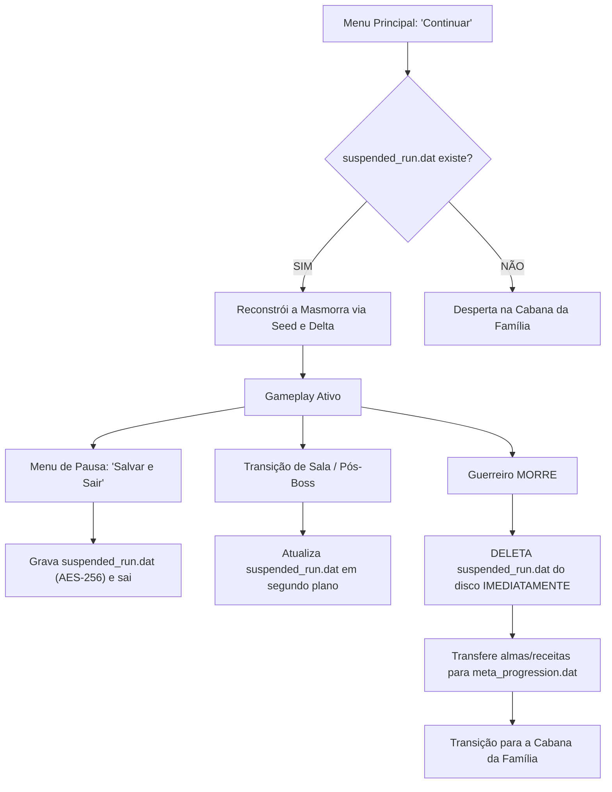

# Arquitetura do Sistema de Save (Estilo Dead Cells)

> **Documento de Arquitetura Técnica & Game Design**  
> **Status:** Especificado e Pronto para Implementação  
> **Padrão:** *Ironman Suspended Run* com Criptografia Nativa AES-256

---

## 1. Visão Geral & Filosofia

Para preservar o espírito genuíno de um **Roguelike de Ação**, o jogo não permite carregamento manual de arquivos de save (*save scumming* / carregar antes do chefe se morrer). 

O sistema segue a arquitetura comprovada de jogos como *Dead Cells*, *Hades* e *Returnal*, baseada em **dois arquivos independentes por perfil de jogador**:

```
user://saves/slot_{id}/
├── meta_progression.dat   <-- Progresso Permanente da Linhagem (NUNCA deletado)
└── suspended_run.dat       <-- Fotografia da Partida Ativa (DELETADO ao morrer)
```

No menu principal, o jogador tem apenas as opções:
* **Continuar:** Carrega a partida suspensa (se houver) ou desperta o guerreiro na Cabana da Família.
* **Nova Expedição:** Inicia uma nova descida a partir da Cabana.
* **Perfis (Slots 1, 2 e 3):** Permite alternar entre diferentes campanhas/jogadores.

---

## 2. Separação dos Arquivos de Dados

### A) Progresso Permanente (`meta_progression.dat`)
Armazena tudo o que sobrevive à morte do guerreiro:
* **Forja do Irmão:** Níveis de aprimoramento de dano das armas e bloqueio dos escudos.
* **Cozinha da Mãe:** Níveis dos chás permanentes, elixires desbloqueados e receitas ativas.
* **Guarda-Roupa da Família:** Skins/túnicas desbloqueadas do guerreiro e cosméticos dos pets (Preta e Bela).
* **Pedestais de Armas e Escudos:** Estado de destravamento dos 6 pedestais de armas e 3 de escudos.
* **Telemetria e Bestiário Histórico:** Total acumulado de almas sugadas, inimigos abatidos por categoria (zumbis, animais, abominações, elites), chefões únicos derrotados, parries perfeitos e mortes registradas.

### B) Save de Suspensão da Run (`suspended_run.dat`)
Representa a existência efêmera de uma única descida à masmorra:
* **Semente Procedural (*Run Seed*):** Número inteiro pseudoaleatório que recria o mapa de forma determinística.
* **Bioma e Fase Atual:** Índice do mundo e sub-nível em que o guerreiro parou.
* **Estado Físico do Guerreiro:** Vida atual (`current_health`), cargas restantes da Garrafa de Chá da Mãe.
* **Arsenal da Partida:** Armas equipadas nas mãos e nas costas (nível temporário, bônus e modificadores da run).
* **Bênçãos Temporárias:** Dádivas ativas adquiridas no Toque da Morte.
* **Economia Volátil:** Almas colhidas na partida atual (sujeitas a perda na morte).
* **Estado Delta do Mundo:** Lista de salas já limpas, baús já abertos e monstros de elite eliminados.

---

## 3. Reconstrução Procedural Determinística (Por que a Run salva tão rápido?)

Em jogos procedurais, **não salvamos blocos, azulejos ou posições de cada partícula**. Isso geraria arquivos de megabytes e micro-travamentos (*hitches*) na gravação.

### O Princípio da Semente (*RNG Seed*)
A geração procedural de mapas é matemática e determinística:
$$\text{Algoritmo do Nível} + \text{Seed (ex: 84920481)} = \textbf{O mesmo mapa idêntico a cada geração.}$$

### O que vai no arquivo (`suspended_run.dat`):
O arquivo pesa menos de **8 Kilobytes** e armazena apenas o *Delta* (o que mudou):

```json
{
  "run_seed": 84920481,
  "current_biome": "floresta_amaldicoada",
  "current_stage": 2,
  "player_state": {
    "current_health": 175.0,
    "max_health": 250.0,
    "flask_charges": 2,
    "current_souls": 84,
    "main_weapon": { "id": "sword_rusty", "level": 2 },
    "secondary_weapon": { "id": "bow_hunting", "level": 1 },
    "active_blessings": ["crit_chance_tier1"]
  },
  "world_delta": {
    "current_room_id": "arena_combate_03",
    "cleared_rooms": ["sala_entrada_01", "corredor_armadilhas_02"],
    "opened_chests": ["bau_corredor_02"],
    "dead_elites": ["elite_guardiao_pedra_01"]
  }
}
```

Ao clicar em **Continuar**:
1. O gerador de níveis recebe a `run_seed` e recria a geometria completa do mapa em milissegundos.
2. O jogo consulta o `world_delta` e suprime inimigos de salas limpas e marca baús já abertos.
3. O jogador é posicionado na porta da sala atual com sua vida e equipamentos exatos.

---

## 4. Ciclo de Vida & Anti-Save Scumming



* **Morte Permadeath:** Se a vida do guerreiro zera, o arquivo `suspended_run.dat` é **destruído do disco** na mesma fração de segundo. Se o jogador fechar o jogo no susto após morrer, não há como voltar à run.
* **Proteção contra Alt+F4 em Chefes:** O salvamento de checkpoint ocorre **ao entrar na sala do chefe**. Se o jogo for finalizado forçadamente durante o combate, ao reabrir ele reinicia a arena do chefe com o HP de entrada, impedindo o abuso de tentativas infinitas.

---

## 5. Segurança & Criptografia (AES-256)

Para impedir adulteração via Bloco de Notas ou editores de texto, o Godot 4 fornece encriptação nativa com algoritmo **AES-256**:

```gdscript
# Escrita Criptografada
var file := FileAccess.open_encrypted_with_pass(save_path, FileAccess.WRITE, SECRET_SALT)
if file:
    file.store_string(payload_json)
    file.flush()
    file.close()

# Leitura Criptografada
var file := FileAccess.open_encrypted_with_pass(save_path, FileAccess.READ, SECRET_SALT)
if file:
    var content := file.get_as_text()
    file.close()
```

### Validação de Integridade (Checksum SHA-256)
Para evitar que editores hexadecimais alterem valores brutos de memória:
* O payload contém um campo `hash_signature` calculado a partir dos dados internos.
* Ao carregar, o jogo recalcula o hash SHA-256. Caso não corresponda, o save é considerado corrompido ou adulterado.

---

## 6. Gatilhos de Salvamento Automático

O jogador nunca precisa se preocupar em apertar "Salvar":
1. **Transição de Portas / Salas:** Gravação em thread secundária ao atravessar checkpoints.
2. **Derrota de Inimigos de Elite ou Chefes:** Registro imediato da vitória e itens derrubados.
3. **Pausa do Jogo ("Salvar e Sair"):** Gravação limpa para permitir pausas no dia a dia.
4. **Interações na Cabana da Família:** Ao comprar infusões com a Mãe, aprimorar equipamentos com o Irmão ou equipar uma túnica.
